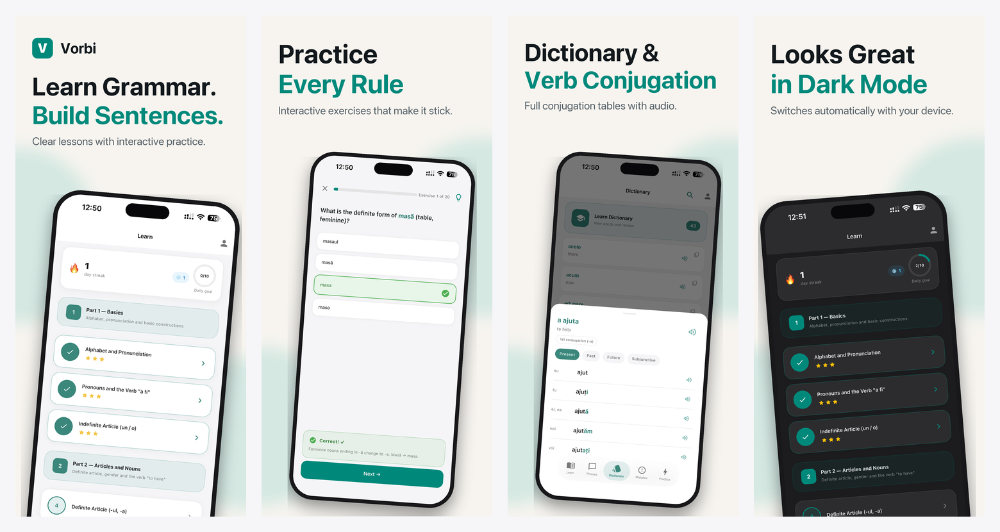
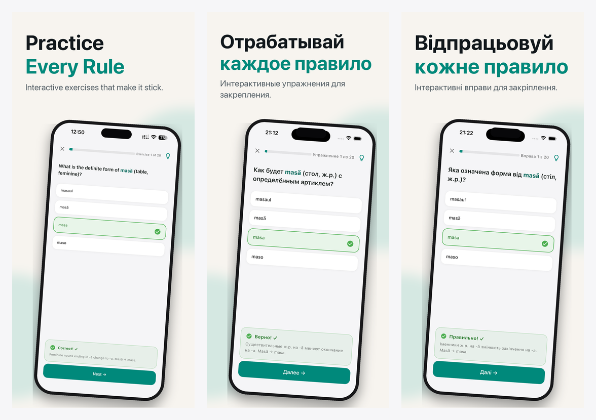

# claude-skills

Claude Code skills I wrote for my own work: shipping indie iOS apps and reviewing code
before a pull request. Each skill is a folder with a `SKILL.md`; Claude Code loads it
when a request matches the skill's description.

| Skill | What it does |
|---|---|
| [`app-store-screenshots`](app-store-screenshots/SKILL.md) | Localized App Store and Google Play screenshot sets from real device captures, composed and checked by a Pillow script |
| [`aso`](aso/SKILL.md) | App Store Optimization audit: name, subtitle and keywords per storefront and its localizations, counted and deduplicated by a script |
| [`branch-review`](branch-review/SKILL.md) | Pre-PR review of the current branch, committed and uncommitted: verified issues by severity, a fix prompt each, contracts across related repos |
| [`flutter-ios27-design`](flutter-ios27-design/SKILL.md) | iOS 26/27 Liquid Glass design for Flutter apps, new or moved off Material, with ready foundation code and a rules check |

## app-store-screenshots

Builds store-ready screenshot sets: real app captures in a drawn device frame, with captions
rendered from per-locale string tables. Adding a language is one more table.

The skill never lets an image model redraw app UI. AI upscaling and redrawing corrupt text
(it turned "casă" into "casa" and "pronunciation" into "prenunciation"), and in a language
app the audience notices at once. So the screen content stays pixel-real, and only the
frame and captions are drawn.

How it works:

1. A compile-time screenshot mode seeds lived-in demo data (streak, progress, no locks) and
   opens each slide's screen by itself, so nothing has to be tapped.
2. Real captures are shot on simulators that match the store slots.
   [`capture_ios_template.sh`](app-store-screenshots/capture_ios_template.sh) builds once, sets
   the 9:41 status bar and shoots every locale × slide; it warns when two locales come out
   identical.
3. [`compositor_template.py`](app-store-screenshots/compositor_template.py) is copied into the
   project and configured: accent color, wordmark, slides, captions per locale. It renders
   iPhone 6.3" (the size Apple requires) and 6.9", iPad 13", Google Play phone and the Play
   feature graphic, plus A/B caption variants. A caption that doesn't fit, a missing glyph, low
   contrast or a size the store would reject stops the run, naming the locale and slide.
4. A review sheet shows each set in a row and at search-result size; every frame is checked
   before upload, and a pitfalls checklist covers the mistakes that already happened once.

I use it for the store screenshots of my own apps. Example output from
[Vorbi: Learn Romanian](https://apps.apple.com/us/app/vorbi-learn-romanian/id6777660039),
seven slides per locale for iPhone, iPad and Google Play:



The same slide in English, Russian and Ukrainian:



## aso

Audits and rewrites App Store metadata per storefront: what search actually indexes (name,
subtitle, keywords, developer name, category, promoted in-app purchases, custom product page
keywords, in-app events), hard rules for the keyword field, and which changes need a new
release versus going live immediately.

- [`check_metadata.py`](aso/scripts/check_metadata.py) reads fastlane-style metadata and prints
  exact `21/30` counts after Unicode normalization, plus everything that wastes the keyword
  field: spaces after commas, words already in the name, subtitle or developer name, plural
  duplicates, repeats across the localizations one storefront shows.
- Storefronts index more than one language (the US also shows Russian and Spanish, Moldova
  only English (U.K.)); the skill plans keywords per storefront with Apple's table.
- Keyword research without paid tools, a safe path for live apps (baseline ranks, re-check
  after release), conversion levers, and a short Google Play reference.

## branch-review

Reviews what the current branch changes against its base — commits plus staged, unstaged and
new files — in seven passes: bugs (including silent failures), security, architecture and
project rules, performance, tests, breaking changes and contracts, and intent (does it do what
the PR or issue says). Before anything reaches the report, each candidate is re-checked in the
code, needs a concrete trigger, and is dropped if it is pre-existing, linter territory or style.

The report opens with a merge verdict and lists at most ten issues by severity, each with
file and lines, the quoted line and a plain-text fix prompt; sections without content are left
out. Reply `fix CRITICAL-1, IMPORTANT-2` and only those get fixed. The review reads only:
nothing is checked out, committed or posted to GitHub.

If the project's `CLAUDE.md` (or one in a parent folder) lists related repositories, the review
follows contracts across them, for example an IDE plugin ↔ webview message schema or a client
↔ backend endpoint.

## flutter-ios27-design

Gives a Flutter app the look of current iOS: Liquid Glass bars, tab bar, buttons and sheets
from [`liquid_glass_widgets`](https://pub.dev/packages/liquid_glass_widgets), with opaque
grouped content underneath, the way Apple's own apps do it.

The package draws the glass; the skill supplies the design around it:

- Apple's iOS 26 colors (Flutter's `CupertinoColors` still have the iOS 13–18 hues) and the
  SF Pro text ramp with Apple's tracking values.
- Glass only on the controls layer, a tinted background wash for it to refract, the iOS 27
  hard scroll edge, continuous corners, 44 pt targets, one-pixel hairlines.
- Foundation code in [`assets/core`](flutter-ios27-design/assets/core) to copy into
  `lib/core`: theme, tab shell with large titles, cards, grouped lists, glass pill buttons,
  sheets, progress ring.
- Accessibility built in: Apple's Increase Contrast colors, Reduce Motion, layouts that hold at
  the largest text sizes, spoken summaries on rings.
- Screen recipes (dashboard, settings, lists, form sheets, onboarding, charts), a migration
  path for Material apps, a review mode, and a check before a screen counts as done:
  [`check_look.sh`](flutter-ios27-design/scripts/check_look.sh) for the rules a grep can see,
  then a simulator in light, dark and at the largest text size.

Tested with `liquid_glass_widgets` 1.15–1.16 on Flutter 3.41+.

## Install

Symlink the skills into your user skills folder so they are available in every project:

```bash
git clone https://github.com/aldanchenko/claude-skills.git ~/Projects/claude-skills
for s in app-store-screenshots aso branch-review flutter-ios27-design; do
  ln -s ~/Projects/claude-skills/$s ~/.claude/skills/$s
done
```

`app-store-screenshots` needs Python 3 with Pillow (`pip install Pillow`); `aso` needs Python 3.

`aso` and `flutter-ios27-design` have `evals/` with test cases (`case.yaml`, `prompt.md`,
`graders/`) in the format `claude plugin eval` and the skill-creator skill read.
`flutter-ios27-design` also has `trigger_evals.json` for tuning when the skill fires.

## License

[MIT](LICENSE)
